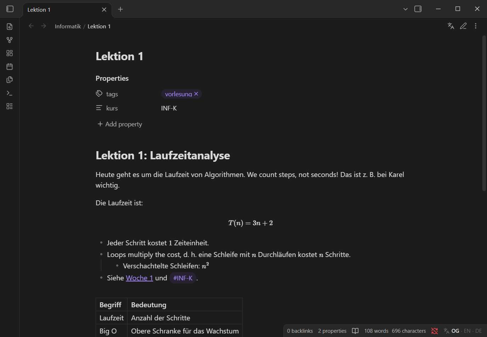
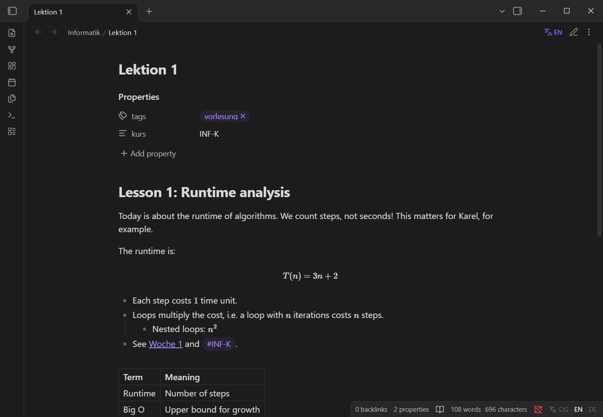
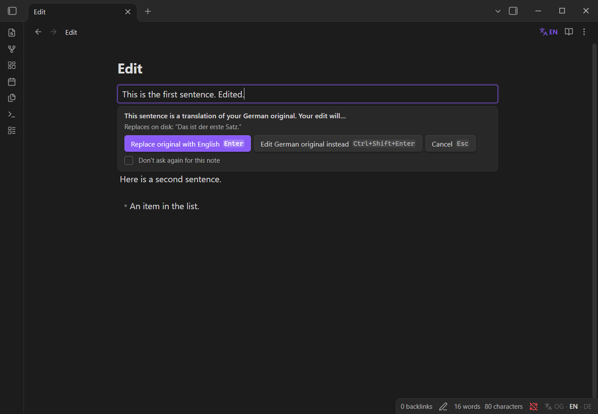
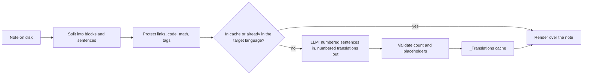

<h1 align="center">Transparent Translate</h1>

<p align="center">
  Write your notes in any mix of German and English, then read them in either language with one click.<br>
  <b>The file on disk never changes.</b>
</p>

<p align="center">
  <a href="https://github.com/CodingJinxx/transparent-translate/actions/workflows/ci.yml"></a>
  <a href="https://github.com/CodingJinxx/transparent-translate/releases/latest"></a>
  
  <a href="LICENSE"></a>
</p>

| Original (as written) | English view |
| --- | --- |
|  |  |

Transparent Translate adds a language switch to every note: **Original → English → German**. Translations are made by any OpenAI-compatible LLM (a local server such as LM Studio, or a cloud provider), cached sentence by sentence in your vault, and shown on top of your text. Search, backlinks, sync and other tools keep seeing exactly what you wrote.

## Features

- **Display only.** Switching languages renders a translation over your note in Reading view and Live Preview. The Markdown file is never rewritten by a mode switch or a translation.
- **Mixed-language notes.** Sentences are translated one by one, so a paragraph that switches between German and English mid-way comes out fully in the target language.
- **Syntax stays intact.** Wikilinks, embeds, Markdown links, URLs, tags, block ids, footnotes, inline code, inline and block math, comments, code blocks and frontmatter are protected and never sent for rewriting.
- **Pays for each sentence once.** Translations are cached by sentence content, so reordering paragraphs or editing one sentence only re-requests what changed. Sentences that are already in the target language are recognised and never sent.
- **Edit in translated views.** Type between sentences as usual. Click a translated sentence to edit it: a small banner asks whether to replace your original with the new text or to edit the original instead. Every change is a normal editor change, so <kbd>Ctrl/Cmd</kbd>+<kbd>Z</kbd> undoes it.
- **Bring your own model.** Presets for LM Studio, OpenAI, OpenRouter and the Meta Model API, or any other OpenAI-compatible endpoint. Fetch the model list and test the connection from the settings.
- **File and folder names.** Optionally show translated names in the file explorer, tab titles, note titles and breadcrumbs. Only the display changes: files and folders are never renamed, and while you rename something you see its real name.
- **A glossary that learns.** Correct a translation from its right-click menu ("Fix translation…") and the plugin remembers: `Schein → course credit` applies to `Scheinkriterien`, `Scheinen` and every other sentence that contains the term, per note, folder, frontmatter property, tag or the whole vault. Let the model list the terms it was unsure about and settle them in one dialog. See [The glossary](#the-glossary).
- **Bulk translation** of a folder, with a token and cost estimate before anything is sent.
- **Mobile: view-only.** Phones and tablets show translations that were generated on a desktop and synced. They never call an API and need no key.
- **English and German interface**, following Obsidian's language setting.

## Editing a translated sentence



| You do | What happens |
| --- | --- |
| Type between sentences, at the end of a block or on a new line | Text goes straight into the file, in the language you type. |
| Click into a translated sentence, or start typing over one | An inline editor opens; nothing is written yet. |
| <kbd>Enter</kbd>, or click elsewhere | Your edited text replaces the original sentence on disk. |
| <kbd>Ctrl/Cmd</kbd>+<kbd>Shift</kbd>+<kbd>Enter</kbd> | Switches to Original and puts the cursor in that sentence. |
| <kbd>Esc</kbd> | Cancels. The file is untouched. |
| Delete a translated sentence | Deleted without a dialog; a notice offers **Undo**. |

Replaced and deleted originals are also kept in a short history, so **Restore replaced original…** works even after the undo history is gone. "Click elsewhere applies", "Ask before deleting" and the default choice can be changed in the settings.

## Installation

### From Obsidian

Once the plugin is listed in the community directory: **Settings → Community plugins → Browse**, search for "Transparent Translate", then **Install** and **Enable**.

### Manually

1. Download `main.js`, `manifest.json` and `styles.css` from the [latest release](https://github.com/CodingJinxx/transparent-translate/releases/latest).
2. Copy them to `<your vault>/.obsidian/plugins/transparent-translate/`.
3. Reload Obsidian and enable **Transparent Translate** under **Settings → Community plugins**.

Requires Obsidian **1.11.4** or later (the API key is kept in Obsidian's secret storage, which arrived in that version).

## Setup

1. Open **Settings → Transparent Translate**.
2. Pick a **Provider**. It fills in the base URL; every field stays editable.
3. Enter the **Model** id, or select **Fetch models** to choose from the server's list.
4. Under **API key**, create a secret with your key and select it. Local servers usually need no key.
5. Select **Test**. It translates "Guten Morgen" and shows the result, latency and token usage.
6. Optional: select **Add exclusion** to hide the cache folder from search and the graph.

Then open a note and select the language button in the note header (or the `OG · EN · DE` item in the status bar), or run **Show English** / **Show German** from the command palette. Nothing is translated until you switch a note.

| Provider preset | Base URL |
| --- | --- |
| LM Studio (local) | `http://localhost:1234/v1` |
| OpenAI | `https://api.openai.com/v1` |
| OpenRouter | `https://openrouter.ai/api/v1` |
| Meta Model API | `https://api.meta.ai/v1` |
| Custom | any OpenAI-compatible `/v1` root |

> [!TIP]
> Reasoning models bill their reasoning as output tokens. If your provider supports it, add `{"reasoning_effort": "low"}` under **Extra request parameters**: translation does not need deep reasoning.

## Commands

No command has a default hotkey; bind your own under **Settings → Hotkeys**.

| Command | |
| --- | --- |
| Show original / Show English / Show German | Set the display language of the current note. |
| Cycle display language | Original → English → German. |
| Show file and folder names in original / English / German | Sets the language of names in the explorer, tabs and titles. Off by default. |
| Fix the translation of a sentence… | Pick a translated sentence and correct a term (also available from the right-click menu of a translated sentence). |
| Review terms in this note… | Asks the model which terms were a judgment call and lets you settle them. |
| Manage translation glossary | List, add, edit and delete glossary entries and the subject area of a scope. |
| Update translations affected by glossary changes | Translates again the sentences of this note whose glossary entries changed (automatic by default). |
| Re-translate this note | Drops this note's cached translations and requests them again. |
| Translate folder… | Counts what is missing, shows a token and cost estimate, and asks before starting. |
| Copy original text | Copies the selection (or the note) as it is on disk. Normal copy copies what you see. |
| Restore replaced original… | Puts back a sentence that an edit replaced or deleted. |
| Clear translation cache for this note / Clear the entire translation cache | Removes cached translations. |
| Prune unused translations | Removes cached sentences that no longer appear in their notes. |

## Privacy and network use

> [!IMPORTANT]
> **Note text is sent to the endpoint you configure.** When a note is switched to English or German (or a folder is bulk-translated), the text of its sentences, the note title and your glossary are sent to that endpoint for translation. With **File and folder names** turned on, the names that are visible in the explorer, tabs and titles (without extension) and the folder they are in are sent as well. Glossary entries, subject areas and meanings are sent only together with the sentences they match. Links, code, math, tags and other protected syntax are replaced by placeholders before sending. Frontmatter and code blocks are never sent.

- **Which service:** only the OpenAI-compatible endpoint you enter in the settings (for example the Meta Model API, OpenAI, OpenRouter, or a local server like LM Studio). With a local server, nothing leaves your computer. Which provider and plan you use, and what their terms allow, is your decision.
- **Account and payment:** a cloud provider needs an account and usually charges per token. Local servers need neither.
- **API key:** stored in Obsidian's secret storage. The plugin's `data.json` only holds the secret's *name*.
- **No telemetry.** The plugin sends nothing else anywhere.
- **Files it writes:** only the cache folder inside your vault (below). Nothing outside the vault.

## The translation cache

Translations live in a visible folder, `_Translations/` by default, one `.md` file per translated note at the same relative path:

```
_Translations/Informatik/Lektion 1.md
```

These files are plain JSON behind a one-line "generated, do not edit" warning. They are regular Markdown files on purpose: **Obsidian Sync only syncs visible folders and, by default, only notes and media**, so this is what lets your phone show translations made on your desktop. Translations are stored with placeholders instead of links and tags, so cache files never add backlinks, tags or graph edges.

- **Hide them from search and the graph:** select **Add exclusion** in the settings. It adds the folder to **Settings → Files and links → Excluded files**.
- **Dataview:** exclude the folder in your queries, for example `FROM -"_Translations"`.
- **Other tools and AI assistants:** treat `_Translations/` as generated output, not as your notes.
- **Names:** translated file and folder names are stored together in one file, `_Translations/_names.md`, keyed by the name (so renaming or moving a note needs no migration).
- **Renaming or deleting a note** moves or deletes its cache file. Renaming the cache folder in the settings moves the existing cache.
- **Uninstalling** leaves the folder in place. Delete it yourself if you no longer need it.

## The glossary

Models pick plausible but wrong words for domain terms (a German *Schein* is not a certificate, *LP* are ECTS credits). The glossary lets you settle a term once.

- **Fix a translation:** right-click a translated sentence (Reading view or Live Preview) and choose **Fix translation…**, or run the command of the same name (this also works on mobile). Click the term in the original, type what it should be, optionally mark wrong words in the translation, and choose where it applies. **Undo** is in the notice.
- **Where it applies:** a note, a frontmatter property (`course: SYS`), a tag, a folder, or the whole vault. The most specific entry wins, so the same word can mean different things in different subjects. The dialog suggests the folder of the note.
- **How terms match:** `Schein` also matches inside `Scheinkriterien` and `Scheinen`; short terms like `LP` match only as whole words. A longer entry overrides a shorter one inside it.
- **Three kinds of entries:** *translate as*, *never translate as* (a word you know is wrong) and *do not translate*. A scope can also carry a short **subject area** ("German university course notes") that is sent with its requests.
- **Review terms in this note…:** one request asks the model which terms it was unsure about, with alternatives. You settle the ones you care about; the model cannot add entries by itself, and it can only name terms that occur in the note.
- **Changes take effect where they matter:** each cached translation remembers which entries applied. When an entry changes, only sentences containing that term are translated again (when you view the note, or with **Update translations affected by glossary changes**). Turn this off under **Settings → Glossary** to update only on command. On mobile the old translation stays until a computer updates it.
- **Where it is stored:** in a note, `Translation glossary.md` by default. It is a visible note like the cache, so it syncs and can be reviewed, but it lives outside the cache folder, so clearing the cache never deletes what you taught the plugin. It is never translated.

## Mobile

On Obsidian mobile the plugin is **view-only**: switch between Original, English and German and read translations that already exist in the synced cache. Sentences without a cached translation are shown in the original language with a dotted underline. No requests are made, no key is needed, and editing works as usual in Original mode.

## Limitations

- Search, backlinks and other plugins only see the original text.
- Translated names are a display layer: the quick switcher, search, graph, links and the explorer's sort order keep using the real names, so translated rows can look unsorted. If two siblings would show the same translated name, both keep their original.
- Translation is between English and German.
- In Live Preview, translations are shown sentence by sentence inside paragraphs, headings and lists. Tables and callouts are translated in Reading view.
- Sentence splitting uses `Intl.Segmenter` plus an abbreviation list (configurable). Unusual punctuation can split or join sentences differently than you would.
- If a model changes or drops placeholders, that sentence is retried once and otherwise shown in the original language, with a dotted red underline.

## How it works



Each sentence is keyed by a SHA-256 of its normalised text. The model returns one `<<n>> {de} …` line per sentence (or JSON in JSON mode): the number keeps sentences aligned, and the tag reports the sentence's language so the other direction never needs a request.

## Development

```bash
npm install
npm run dev          # watch build; set OBSIDIAN_PLUGIN_DIR to copy each build into a vault's plugin folder
npm run check        # typecheck, lint, guideline check, unit tests
npm run test:e2e     # end-to-end tests in a sandboxed Obsidian (minAppVersion, latest, mobile emulation)
npm run test:live    # optional: real endpoint from .llm_connection_details.json (git-ignored)
npm run screenshots  # regenerate the README screenshots
```

See [CONTRIBUTING.md](CONTRIBUTING.md) for the project layout, the test setup and the release process.

## Acknowledgements

Built on the official [Obsidian sample plugin](https://github.com/obsidianmd/obsidian-sample-plugin) template and API. End-to-end tests use [wdio-obsidian-service](https://github.com/jesse-r-s-hines/wdio-obsidian-service). No third-party code is bundled into the plugin.

## License

[MIT](LICENSE) © Jay Leimer
